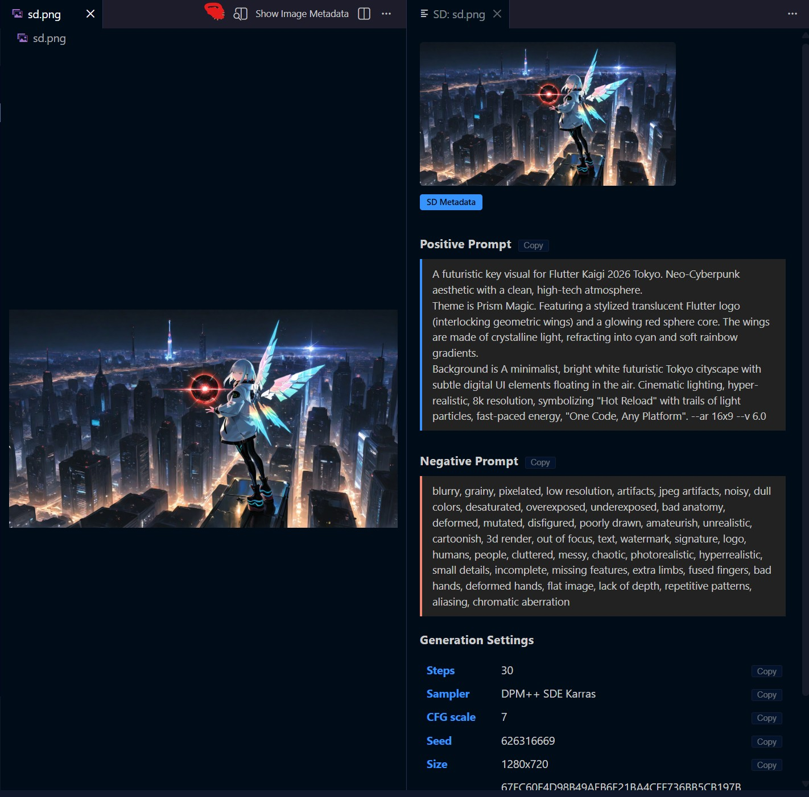

# Image Metadata Viewer

A Visual Studio Code extension that displays image metadata — Stable Diffusion (A1111 format), ComfyUI node graphs, and JPEG EXIF data — in a dedicated side panel.

## Features

- **Stable Diffusion metadata** display (A1111 format) from PNG files
- **ComfyUI node graph** metadata display from PNG files
- **ComfyUI workflow export** — save the workflow (UI format) or API prompt as JSON, and inspect every node in the graph
- **EXIF data** display with categorized view from JPEG files
- **Thumbnail preview** in the metadata panel
- **Copy buttons** for prompts, settings rows, and raw data
- **Auto-sync** with the active editor tab
- **Nonce-based Content Security Policy** for webview security
- **VS Code theme integration** using native theme variables

## Screenshots



## Installation

### From VSIX

1. Download the `.vsix` file from the [Releases](../../releases) page.
2. In VS Code, open the Command Palette (`Ctrl+Shift+P`).
3. Run **Extensions: Install from VSIX...** and select the downloaded file.

### From Source

```bash
git clone https://github.com/granoeste/image-metadata-viewer.git
cd image-metadata-viewer
npm install
npm run compile
npm run package
```

Then install the generated `.vsix` file as described above.

## Usage

There are three ways to view image metadata:

- **Right-click context menu**: Right-click an image file in the Explorer and select **Show Image Metadata**.
- **Editor title button**: Open an image file and click the metadata button in the editor title bar.
- **Auto-sync**: Once the metadata panel is open, it automatically updates when you switch between image files.

To save a ComfyUI workflow as JSON, use the **Export** buttons in the metadata panel, or right-click a PNG in the Explorer and select **Export ComfyUI Workflow**. Both the UI-format workflow (`.workflow.json`) and the API-format prompt (`.api.json`) can be loaded into ComfyUI by drag & drop.

## Supported Formats

### PNG — Stable Diffusion (A1111)

Reads the `parameters` key from PNG tEXt chunks and parses it as A1111-format metadata.

| Section | Details |
|---------|---------|
| Positive Prompt | Full prompt text with copy button |
| Negative Prompt | Full prompt text with copy button |
| Generation Settings | Key-value table (Steps, Sampler, CFG Scale, Seed, Size, Model, etc.) with per-row copy |
| Raw Metadata | Collapsible raw text with copy button |

### PNG — ComfyUI

Reads `prompt` and `workflow` keys from PNG tEXt chunks and extracts node graph information.

| Section | Details |
|---------|---------|
| Export | Save the workflow (UI format) / API prompt as JSON |
| Positive Prompt | Traced from the sampler through linked nodes (switches, primitives, string ops, custom encoders) |
| Negative Prompt | Traced from the sampler through linked nodes |
| Generation Settings | Extracted parameters table (image size falls back to the PNG dimensions) |
| Workflow Nodes | Every node in dependency order with parameters and input links |
| Raw Prompt JSON | Collapsible JSON with copy button |
| Raw Workflow JSON | Collapsible JSON with copy button |

### JPEG — EXIF

Parses APP1 segment TIFF/IFD structures from JPEG files.

| Category | Examples |
|----------|----------|
| Camera | Make, Model, Software |
| Shooting | Exposure Time, F-Number (Aperture), ISO, Focal Length |
| Image | Width, Height, Orientation, Color Space |
| GPS | Latitude, Longitude, Altitude |
| Other | Additional EXIF tags |

## Requirements

- VS Code 1.85.0 or later

## License

MIT
